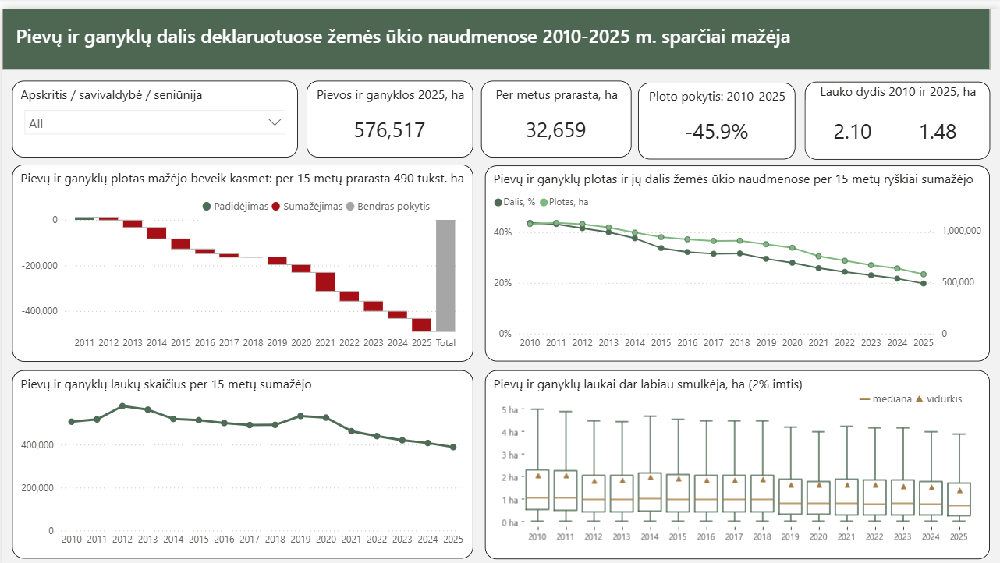
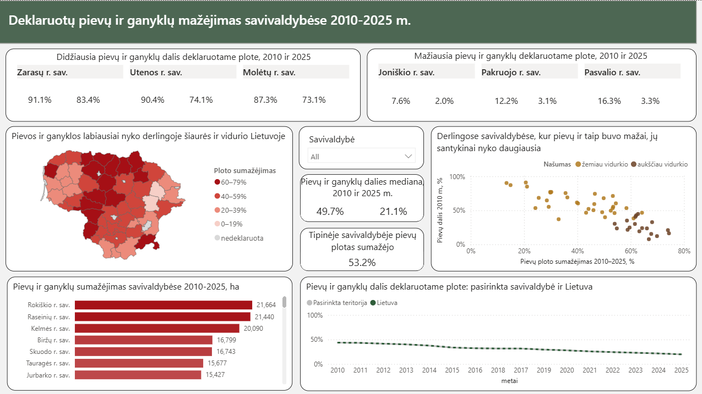
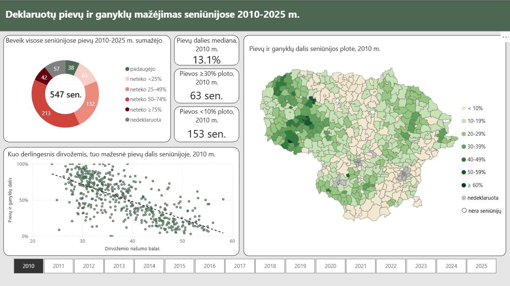
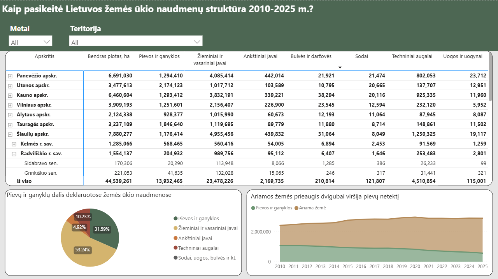

# Decline of Meadows and Pastures in Lithuania, 2010-2025

Built a Power BI dashboard to analyse agricultural areas declared under the EU Common Agricultural Policy in Lithuania 2010-2025, at national, municipality and eldership (seniūnija) level, with a focus on meadows and pastures.

Dashboard language: Lithuanian.

## Key findings
- Over the last 15 years, meadows and pastures shrank by almost half - from **1.07 to 0.58 million ha** (-46%).
- In the median municipality, meadows and pastures lost **53%** of their area; their share of declared agricultural land fell from **50% to 21%**.
- Meadows and pastures declined in **451 of 490** elderships with data; **255** of them lost at least half.
- The higher the soil productivity score, the lower the share of meadows and pastures.
- Arable land grew by **0.97 million ha**, which is about twice the meadow and pastures loss.

## Dashboard
### 1.Decline of meadows and pastures in Lithuania (Pievų ir ganyklų mažėjimas Lietuvoje)


### 2. Municipalities (Savivaldybės)


### 3. Elderships (Seniūnijos)


### 4. Agricultural land use structure (Naudmenų struktūra)


## Pipeline
CSV files -> Python -> MySQL -> Power BI

| Step | File | What it does |
|---|---|---|
| 1 | `python/00_import_csv_to_mysql.ipynb` | Loads yearly declaration CSV files (7 land use groups, 2010-2025) into MySQL with pandas and SQLAlchemy |
| 2 | `sql/01_land_use_by_eldership.sql` | Aggregates each land use group by eldership and year, appends 2010-2025, merges all groups, adds county and municipality totals -> `final20102025` |
| 3 | `sql/02_meadow_fields_and_sample.sql` | Field counts and field size statistics per eldership (`pg20102025laukai`) and a random ~2% sample of meadow fields (`pg20102025sample`) |
| 4 | `powerbi/lt_meadows_dashboard.pbix` | Data model, Power Query, DAX measures, report |


## Tools
- **Python:** pandas, SQLAlchemy (data import)
- **MySQL:** aggregation, joins, window functions
- **Power BI**:
  - DAX measures: medians, shares, comparisons over time, conditional counts, dynamic titles
  - Power Query: data import from multiple sources, cleaning, calculated columns, merges, appends.
  - Maps: TopoJSON maps of municipalities and elderships
  - Python visual: boxplot of field sizes (seaborn)

## Data sources
- Declared agricultural land by land use group (7 datasets), 2010-2025: VĮ Žemės ūkio duomenų centras, [open data](https://zudc.lt/atviri-duomenys/) via data.gov.lt

  <details>
  <summary>All 7 declared land datasets</summary>

- [Meadows and pastures](https://data.gov.lt/dataset/deklaruoti-pievu-ir-ganyklu-plotai)
- [Cereals](https://data.gov.lt/dataset/deklaruotu-javu-plotu-pasiskirstymas)
- [Legumes](https://data.gov.lt/dataset/deklaruotu-ankstiniu-javu-plotu-pasiskirstymas)
- [Technical crops](https://data.gov.lt/dataset/deklaruotu-techniniu-augalu-plotai)
- [Potatoes and vegetables](https://data.gov.lt/dataset/deklaruoti-bulviu-ir-darzoviu-plotai)
- [Berries](https://data.gov.lt/dataset/deklaruoti-uogynu-plotai)
- [Orchards](https://data.gov.lt/dataset/deklaruoti-sodu-plotai)
</details>

- Municipalities (Savivaldybės) [Wikipwdia](https://lt.wikipedia.org/wiki/Lietuvos_savivaldyb%C4%97s)
- Elderships (Seniūnijos) [Wikipwdia](https://lt.wikipedia.org/wiki/Lietuvos_seni%C5%ABnijos)
- Soil productivity scores (2023): [gis.zis.lt](https://gis.zis.lt/arcgis/rest/services/ZIS/Dirv_DR10LT_vertinimas_2023/MapServer), loaded via its REST API
- Municipality boundaries: [geoBoundaries, LTU ADM2](https://github.com/wmgeolab/geoBoundaries/tree/main/releaseData/gbOpen/LTU/ADM2)
- - Eldership boundaries: Registrų centras, [data.gov.lt](https://data.gov.lt/datasets/1346/)

## Methodology notes
- Meadows and pastures = permanent and temporary grassland declared under the EU Common Agricultural Policy.
- Arable land = cereals, legumes, potatoes and vegetables, technical crops.
- Six municipalities without registered elderships (Alytus, Klaipėda, Panevėžys, Palanga, Neringa, Visaginas) are not drawn on the eldership map.
- Elderships reorganised during 2010-2025 have no 2010-2025 change
- Field size distribution (boxplot) is based on a random ~2% sample of meadow and pastures fields, so it is only shown at national level, not by eldership.
- Urban elderships without meadows and pastures are kept as 0% and therefore lower the eldership medians.


## Repository structure
```
powerbi/   dashboard (.pbix, .pdf)
python/    data import
sql/       data processing in MySQL
maps/      TopoJSON maps used in Power BI
images/    dashboard screenshots
```

## How to open
Download `powerbi/lt_meadows_dashboard.pbix` and open it in Power BI Desktop,
or view `powerbi/lt_meadows_dashboard.pdf`.
The report opens with saved data; refreshing requires the local MySQL database
and local source files.